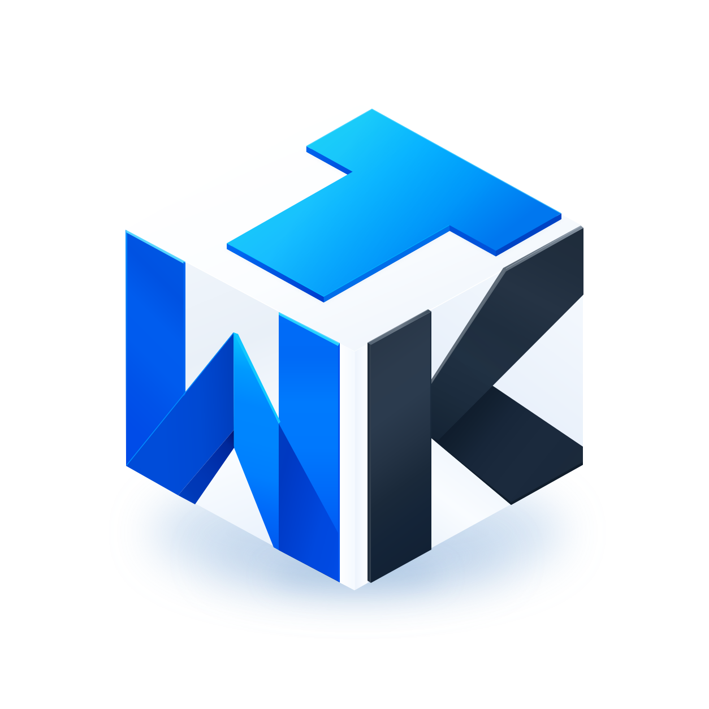

# WinTestKit

Write and run UI tests for **Windows WPF applications** with Python, pytest and VS Code.
WinTestKit finds controls through Microsoft UI Automation, not image matching. You describe
windows and controls in reusable page classes, interact with them, and assert their state.
You do not need to modify the application under test.

This guide takes you from installation to a basic test suite against **your own application**.
No example applications or application binaries are bundled. The [Calculator example](examples/calculator-tests)
demonstrates page models, reusable navigation flows, fixtures and parametrized tests against Windows Calculator.

## 1. Prepare your machine

You need:

- Windows 10 or 11 with an interactive, unlocked desktop while inspecting or running UI tests.
- Python 3.12 or later.
- Your application's executable and any data or accounts needed for testing.
- VS Code with its Python extension if you want the visual Spy and Test Explorer.
- The application and WinTestKit running at the same elevation level. If the app runs as
  administrator, your terminal and VS Code must run as administrator too.

The commands below use PowerShell. Keep the test desktop available: locking the session can
prevent UI Automation, screenshots and mouse input from working.

## 2. Install the Python package

Create a folder and virtual environment for your tests:

```powershell
mkdir orders-tests
cd orders-tests
py -3.12 -m venv .venv
.\.venv\Scripts\Activate.ps1
```

Install a WinTestKit wheel from a release or your local build, together with pytest.
Replace the wheel path with the actual file you downloaded or built:

```powershell
python -m pip install "C:\Downloads\wintestkit-0.1.0-py3-none-any.whl" pytest
wtk --version
```

To work directly from a checkout instead, install the Python package in editable mode in
that same virtual environment:

```powershell
python -m pip install -e "C:\src\wintestkit\python" pytest
```

If PowerShell blocks activation, you can use `.\.venv\Scripts\python.exe` and
`.\.venv\Scripts\wtk.exe` directly instead of activating the environment.

### Install the VS Code extension (optional)

1. In VS Code, open **Extensions**, choose **Install from VSIX...** from the menu, and select
   the WinTestKit `.vsix` file from a release or local build.
2. Open your `orders-tests` folder.
3. Run **Python: Select Interpreter** and select `.venv\Scripts\python.exe`.
4. Make sure the Python package is installed in that interpreter, not just globally.
5. After updating the Python package, run **WinTestKit: Restart Server**.

The extension is a UI for the Python backend; installing the VSIX alone does not install
pytest or prepare your test environment.

## 3. Initialize a test project

From your test folder, point WinTestKit at the application you want to test:

```powershell
wtk init --app "C:/Program Files/Contoso/Orders.exe"
```

This creates a starter page, a smoke test and project settings without overwriting existing
files. You can also use **WinTestKit: Initialize Project** in VS Code.

Your project will look like this:

```text
orders-tests/
  .venv/
  pyproject.toml
  wintestkit.yaml
  wintestkit.local.yaml
  .gitignore
  pages/
    __init__.py
    main.py
  tests/
    test_smoke.py
```

Shared settings go in `wintestkit.yaml`:

```yaml
launch: per-session
timeout: 10
```

Machine-specific settings go in Git-ignored `wintestkit.local.yaml`:

```yaml
app:
  path: C:/Program Files/Contoso/Orders.exe
```

In VS Code, use the **Current Setup** gear above Pages to edit these files with the custom
YAML configuration editor. `pyproject.toml` retains pytest configuration, and legacy
`[tool.wintestkit]` settings remain supported. Use your real executable path; relative paths
resolve from the project directory.
`per-session` launches the app once for the test run and closes it afterwards. Use `per-test`
for a fresh application per test, or `attach` to use an application that is already running.
See [configuration and launch modes](docs/guide/running-tests.md).

Check the environment before continuing:

```powershell
wtk doctor
```

Review any failures before running tests. The [troubleshooting guide](docs/guide/troubleshooting.md)
covers desktop access, elevation, interpreter selection and locator problems.

## 4. Inspect your application's controls

Launch your application manually, or run **WinTestKit: Launch App** in VS Code.

In the **Spy** view, browse the object tree or use the picker to select a control in your
application. Inspect its properties and suggested locator, then insert or copy that locator
into your page class. Selecting an object highlights it and attempts to bring its owning
window to the foreground.

You can also inspect from the terminal:

```powershell
wtk spy
```

Hold **Ctrl** and click a control to pick it; press **Esc** to exit. `wtk inspect` prints the
configured application's UI Automation tree. The CLI Spy does not launch your app for you.

Prefer a stable `automation_id` when available. Otherwise combine properties such as
`control_type`, `name`, `class_name` and a containing element (`within=`). Locators are strict:
if several controls match, narrow the locator instead of relying on an arbitrary match.

## 5. Describe a page

Replace the generated `pages/main.py` with a model of your actual window and controls.
For an application with a login form, it might look like this:

```python
from wintestkit import Element, Page, Window


class MainPage(Page):
    window = Window(title="Contoso Orders")

    username = Element(automation_id="UsernameTextBox")
    password = Element(automation_id="PasswordTextBox")
    sign_in = Element(control_type="Button", name="Sign in")
    status = Element(automation_id="StatusText")
```

**These names and IDs are illustrative.** Replace the title and locators with values from
Spy for your own application. Do not assume it exposes these AutomationIds.

With the application open, verify the locators:

```powershell
wtk highlight pages/main.py::MainPage.sign_in
wtk check pages/main.py
```

In VS Code, use the **Highlight** and **Check** CodeLens actions above your page elements.
See [pages and elements](docs/guide/pages-and-elements.md) and
[locator strategies](docs/guide/locators-for-wpf.md) for nested controls, lists and dialogs.

## 6. Create a basic test suite

Keep the generated smoke test, updating its page or expectations if needed. Add
`tests/test_login.py` for a first interaction test:

```python
from wintestkit import expect

from pages.main import MainPage


def test_valid_login(app):
    main = MainPage(app)
    main.username.type("test-user")
    main.password.type("test-password")
    main.sign_in.click()
    expect(main.status).to_have_text("Welcome, test-user")
```

The `app` fixture comes from WinTestKit's pytest plugin. It launches or attaches to the app
using your project settings. Actions and assertions wait automatically; avoid fixed sleeps.
Use a dedicated test account and do not commit real credentials.

Add more `test_*.py` files under `tests/` and share reusable window/control definitions under
`pages/`. Tests should start from a known state: reset the app through a fixture or choose
`launch = "per-test"` when a fresh process provides the isolation you need. See the
[Calculator tests](examples/calculator-tests) for fixture and parametrization patterns;
adapt their app-specific locators when targeting your own application.

## 7. Run tests and read the results

From the test project folder:

```powershell
wtk run
wtk run tests/test_login.py
wtk run --junit junit.xml
wtk report --open
```

Run one of the `wtk run` commands for the scope you want. Runs write an HTML report to
`wtk-report/index.html`. Failures include diagnostics and, when capture is possible,
screenshots and a UI tree dump. `--junit` also writes results for CI tools.

In VS Code, use the **Testing** view to run or debug tests and **WinTestKit: Open Last Report**
to open the latest report. If tests appear twice, disable the Python extension's pytest
discovery for this workspace or accept WinTestKit's prompt to do so.

## Next steps

- [User guide](docs/guide/index.md): actions, assertions, timeouts and advanced configuration.
- [VS Code guide](docs/guide/vscode.md): Spy, CodeLens, settings and test debugging.
- [CI guide](docs/guide/ci.md): run UI suites on an interactive Windows test machine.
- [Calculator example](examples/calculator-tests): pages, navigation flows and tests for Windows Calculator.
- [Development guide](docs/development.md): build, validate and package this repository.

Created in [T3 Code](https://t3.codes).
